<div align="center">

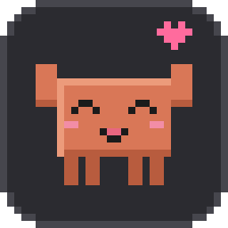

# Claude Pet

**A tiny pixel-art pet that lives on your taskbar and shows what Claude Code is doing, and how much usage you have left.**

[](https://github.com/HrZizi/claude-pet/actions/workflows/ci.yml)
[](LICENSE)


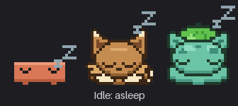

</div>

Claude Code is great at running for minutes while you do something else. **Claude Pet** sits on the edge of your taskbar (or macOS Dock) so you can see at a glance whether it is still thinking, finished, or stuck waiting for you, without alt-tabbing to check.

> Unofficial community project. Not affiliated with or endorsed by Anthropic. See [Disclaimer](#disclaimer).

## Features

- **Reacts to Claude Code in real time**: asleep when idle, typing on a laptop while Claude works, *distraught* when it needs your permission, jumping for joy when it is done, and begging to be petted afterwards. Click it to pet it.
- **Three pets** (Claude, Eevee, Bulbasaur) and **custom sprite packs**: draw your own pet in any pixel-art editor and drop it in. See [Custom pets](#custom-pets-sprite-packs).
- **Usage card**: your real 5-hour and weekly limits (with reset countdowns), or tokens used, per account. Click it to flip between views, or let it rotate.
- **Multiple accounts**: detects your CLI login and every Claude Desktop account automatically, and follows whichever account the active session belongs to.
- **Sits on the taskbar edge, but moves anywhere**: drag it; it snaps back onto the taskbar / Dock when dropped nearby. Multi-monitor aware.
- **Polished context menu** styled like the card, light and dark theme aware, always on top.
- **Zero dependencies**: pure Python standard library (Tkinter). A single self-contained installer for Windows.
- **Private by design**: no telemetry. See [Privacy & security](#privacy--security).

<div align="center">
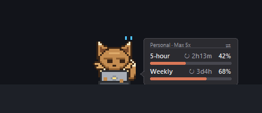
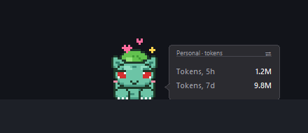
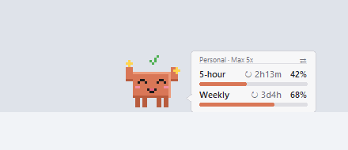
</div>

## Install

### Windows (recommended)

Download from the [latest release](https://github.com/HrZizi/claude-pet/releases/latest):

| Download | What it is |
|---|---|
| **`ClaudePet-Setup-x.y.z.exe`** | Installer. Per user, no admin rights, Start menu shortcut, appears in *Settings → Apps* so you can uninstall it normally. |
| **`ClaudePet-x.y.z-windows-portable.zip`** | Portable. Unzip anywhere, run `ClaudePet.exe`. Keeps its settings in a `data` folder next to it (nothing in AppData). |

With the installer, keep **"Connect to Claude Code"** ticked: it adds a few hooks to `~/.claude/settings.json` (a backup is written first). With the portable zip, right-click the pet → **Connect to Claude Code (hooks)** once. Restart open Claude Code sessions afterwards so they load the hooks.

> The executables are not code-signed, so Windows SmartScreen may warn on first run ("More info" → "Run anyway"). You can always build from source.

### macOS (experimental)

macOS support is implemented but has **not been tested on real hardware yet** ([details](docs/MACOS.md)). Download `ClaudePet-x.y.z-macos.zip`, or install with Python:

```bash
pipx install "claude-pet[mac]"    # or: pip install "claude-pet[mac]"
claude-pet install                # add the Claude Code hooks
claude-pet                        # run the pet
```

### From source (any platform with Python 3.9+ and Tk)

```bash
git clone https://github.com/HrZizi/claude-pet.git
cd claude-pet
python -m venv .venv && . .venv/bin/activate      # Windows: .venv\Scripts\activate
pip install -e .
claude-pet install      # connect to Claude Code
claude-pet              # run (use pythonw -m claude_pet on Windows to avoid a console window)
```

Try it without Claude at all: `claude-pet --demo` runs with canned accounts and usage.

## The pets

<div align="center">
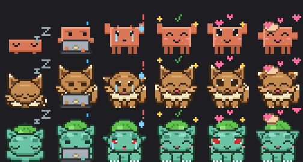
</div>

| Claude is... | The pet... |
|---|---|
| **idle** (nothing for 20 s) | curls up asleep, *zzz* |
| **working** | sits behind a little laptop, eyes scanning, paws typing, "…" bubble |
| **waiting for you** (permission prompt) | is distraught: drooping ears, tears, sweat drop, trembling |
| **just finished** | hops for joy with sparkles |
| **finished, waiting** | big sparkly eyes, wagging tail, hearts: *pet me!* (up to 2 min) |
| **you click it** | purrs while a hand strokes its head |

<details>
<summary>Individual animations (GIFs)</summary>

| Claude | Eevee | Bulbasaur |
|---|---|---|
| 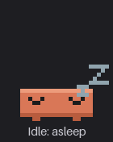 | 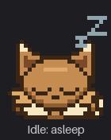 | 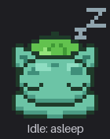 |

</details>

Right-click → **Preview animation** to see any state on demand (it ends by itself after 20 seconds).

### Custom pets (sprite packs)

Every pet, including the three shipped ones, is a **sprite pack**: a folder with a `pack.json` and PNG strips. Packs are
data only, never code, so they are safe to install. A pack with just an `idle` animation already works: Claude Pet adds
the sleeping *zzz*, typing dots, distress, sparkles, hearts and petting hand for you.

```bash
claude-pet pack new my-pet --name "My Pet"   # scaffold a working pack to edit
claude-pet pack validate my-pet              # check it
claude-pet pack install my-pet               # then: right-click > Pet > Reload sprite packs
```

Or right-click → **Pet → Add sprite pack...** to install a `.zip`, **Open sprite packs folder** to drop folders in. Start
from a shipped pet with `claude-pet pack export eevee my-eevee`. Full format and tips: **[docs/SPRITE_PACKS.md](docs/SPRITE_PACKS.md)**.

## Usage card & accounts

The card next to the pet shows, for the **active account**:

- **Limits view**: 5-hour and weekly usage with reset countdowns (needs *Fetch real limits*, below).
- **Tokens view**: tokens used in the last 5 hours / 7 days, counted from your local Claude Code transcripts and attributed to the account that owns each session.

Click the card to switch between *rotate / limits / tokens*. Click its header line to switch account.

<div align="center">
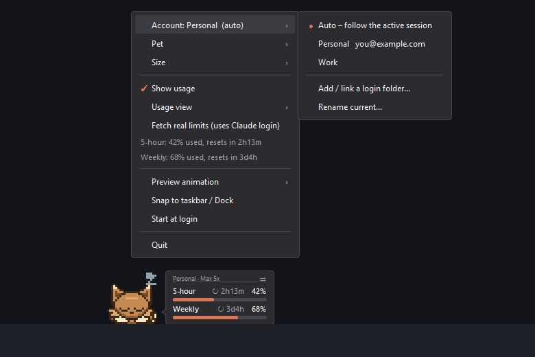
</div>

### Account detection

Claude Pet finds accounts **without touching any credentials**: your CLI login from `~/.claude.json`, and every Claude Desktop account from the Desktop app's session records. In **Auto** mode the card follows the account that owns the session currently running. Details in [docs/ACCOUNTS.md](docs/ACCOUNTS.md).

### Real limits (opt-in)

Right-click → **Fetch real limits (uses Claude login)** reads the login token that Claude Code stored for the CLI and makes one read-only request every 3 minutes to Anthropic's usage endpoint (the data behind `/usage`).

- The Claude **Desktop app's own login is encrypted by your OS and is never read**. A Desktop-only account therefore shows tokens only.
- To see its limits too: *Account → Add / link a login folder…*. It copies a `CLAUDE_CONFIG_DIR=<folder> claude` command; run it once, `/login` with that account, and Claude Pet links the folder to the matching Desktop account automatically.
- The endpoint is undocumented and may change. Everything else keeps working if it does.
- **Please read Anthropic's current terms before enabling it.** It reuses the access token Claude Code stores for itself, from a third-party tool. It is off by default, and you use it at your own risk.

## Configuration

Right-click the pet for everything. Settings are stored in a per-user folder (never in the install folder):

| OS | Location |
|---|---|
| Windows | `%LOCALAPPDATA%\ClaudePet` |
| macOS | `~/Library/Application Support/ClaudePet` |
| Linux | `~/.local/share/claude-pet` |

Override with the `CLAUDE_PET_HOME` environment variable. `config.json` also accepts `token_budget_5h` / `token_budget_7d` to show tokens as a percentage.

## Command line

```text
claude-pet [pet]       run the pet (default); --demo for canned data
claude-pet install     add the Claude Code hooks   (--statusline: also set the CLI status line)
claude-pet uninstall   remove them again
claude-pet limits      print your 5h / weekly limits
claude-pet doctor      diagnostics for bug reports (no tokens)
```

## How it works

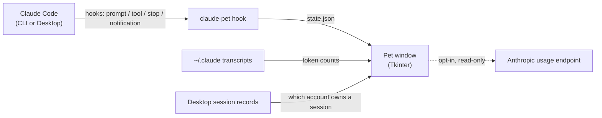

The hook is a tiny dependency-free command (about 90 ms) that records `working`, `attention` or `done` per session. The pet polls that file and animates. Architecture notes: [docs/ARCHITECTURE.md](docs/ARCHITECTURE.md).

## Privacy & security

- **No telemetry, no analytics, no accounts.** Nothing leaves your machine except the optional limits request below.
- **Reads** (all local): Claude Code transcripts for token counts, `~/.claude.json` (account id + e-mail for labels), the Desktop app's session records (account ids). Transcript lines are parsed in memory only to pull out token counts; their content is never stored or sent anywhere.
- **Network**: only when *Fetch real limits* is on: `GET` requests to `api.anthropic.com` with the CLI's own access token, every 3 minutes. The token stays in memory for the request; it is never written, logged, refreshed or sent elsewhere.
- **Writes**: its own data folder, and, only if you connect it, hook entries in `~/.claude/settings.json` (with a timestamped backup). `claude-pet uninstall` removes exactly those entries.
- Report vulnerabilities as described in [SECURITY.md](SECURITY.md).

## Troubleshooting

| Symptom | Fix |
|---|---|
| Pet never reacts | `claude-pet doctor` → hooks must be *installed*; restart open Claude sessions |
| Shows tokens, not limits | enable *Fetch real limits*; Desktop-only accounts need a [linked login](#real-limits-opt-in) |
| "login token expired" | use Claude Code once; it refreshes the token |
| Pet hidden behind taskbar | right-click → *Snap to taskbar / Dock* |

More in [docs/TROUBLESHOOTING.md](docs/TROUBLESHOOTING.md).

## Development

```bash
pip install -e ".[dev]"
python -m pytest                          # unit tests (no display needed)
python scripts/make_assets.py --screens   # regenerate icon, GIFs and screenshots (uses demo data)
python scripts/build.py                   # -> dist/: installer + portable zip (Windows), .app zip (macOS)
```

Project layout:

```text
src/claude_pet/
  app.py            the pet window, animation loop, usage card, menu wiring
  cli.py            command line entry point
  art/              pack.py (sprite pack loading / validation / install), engine.py (frames, motion, effects), png.py (stdlib PNG), glyphs.py
  claude/           everything that talks to Claude Code: accounts, usage, limits_api, hook, integration
  ui/               popup_menu.py (custom context menu), platform_support.py (Windows / macOS specifics)
packs/ (inside src/claude_pet)   the built-in pets as sprite packs (pack.json + PNG strips)
assets/             app icon (.ico / .icns / .png)
docs/               architecture, accounts, macOS, troubleshooting + README images
packaging/          PyInstaller spec, Windows installer / uninstaller (setup_app.py)
scripts/            build, asset generation, procedural/ (source art of the built-in pets) + bake_builtin_packs.py
tests/              pytest suite
```

See [CONTRIBUTING.md](CONTRIBUTING.md). Adding a pet means creating a sprite pack (no code needed).

## Roadmap

- [ ] Verify and polish macOS on real hardware
- [ ] Linux (X11) support
- [ ] Signed Windows builds
- [ ] A gallery of community sprite packs

## Disclaimer

Claude Pet is an independent, unofficial community project. "Claude" and "Claude Code" are trademarks of Anthropic, PBC. Eevee and Bulbasaur are trademarks of Nintendo / Creatures Inc. / GAME FREAK inc.; the sprites in this repository are original fan-made pixel art, are not affiliated with or endorsed by those companies, and are included purely as a homage. The usage-limits feature calls an undocumented Anthropic endpoint and may stop working at any time.

## License

[MIT](LICENSE)
